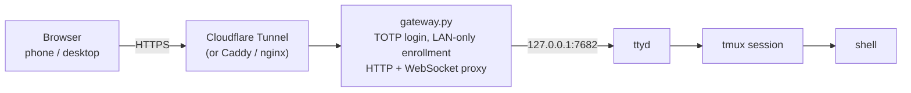

# Web Terminal Gateway

A self-hosted way to reach a terminal on a private machine from any browser:
ttyd stays on loopback, a small Python gateway adds Microsoft Authenticator
(TOTP) login, and the shell lives in tmux so closing a tab, locking a phone, or
clicking over to email never kills it.



## What it gives you

- **Authenticator login.** 6-digit TOTP codes from Microsoft Authenticator
  (or any standard authenticator app). No passwords to the shell.
- **Sessions that stay signed in.** The browser cookie lasts 400 days and the
  token is stored on disk, so a dashboard restart does not log you out.
- **Enrollment only from the LAN.** The QR code and manual key are served only
  to direct private-network requests with dashboard admin auth; requests that
  arrive through a tunnel are refused, even if they know the password.
- **A shell that never dies.** ttyd runs `tmux new-session -A -s main`, so a
  dropped WebSocket detaches a client instead of ending the shell.
- **Automatic reconnect.** A script injected into ttyd's page reloads or
  rejoins on `visibilitychange`, `focus`, `online`, bfcache restores, and when
  ttyd gives up with its "Press Enter to Reconnect" overlay. Works around
  desktop tab freezes and iOS app switching.
- **No Python dependencies.** Standard library only; installs with `ttyd`,
  `tmux`, and `qrencode`.

## Quick start

On a Debian/Ubuntu host, from this checkout:

```sh
sudo ./install.sh
```

It installs `ttyd`, `tmux`, `qrencode`, copies the gateway to
`/opt/web-terminal-gateway`, creates `/var/lib/web-terminal-gateway` for state,
and enables two services:

| Service | Purpose |
| --- | --- |
| `web-terminal.service` | ttyd on `127.0.0.1:7682`, wrapped in tmux |
| `web-terminal-gateway.service` | TOTP gateway on `0.0.0.0:8787` |

Then:

1. Open `http://<lan-ip>:8787/enroll` **on the LAN**.
2. Enter the generated admin password (printed by the installer, stored in
   `/var/lib/web-terminal-gateway/admin-password`).
3. Scan the QR code with Microsoft Authenticator.
4. Open `http://<lan-ip>:8787/terminal` and enter the current 6-digit code.

## Expose it publicly (Cloudflare Tunnel)

```sh
cloudflared tunnel login
cloudflared tunnel create webterm
cloudflared tunnel route dns webterm term.example.com
```

`~/.cloudflared/config.yml`:

```yaml
tunnel: <tunnel-id>
credentials-file: /home/<user>/.cloudflared/<tunnel-id>.json
ingress:
  - hostname: term.example.com
    service: http://127.0.0.1:8787
  - service: http_status:404
```

```sh
sudo cloudflared service install
sudo systemctl enable --now cloudflared
```

Cloudflare terminates TLS and adds `CF-Connecting-IP` / `CF-Ray`, which the
gateway treats as "not LAN", so `/enroll` stays private. Set
`Environment=COOKIE_SECURE=1` in `web-terminal-gateway.service` when the public
URL is HTTPS **and** you do not need to log in over plain LAN HTTP.

Any other TLS reverse proxy works too; point it at `http://127.0.0.1:8787`.

## Configuration

Environment variables for `web-terminal-gateway.service`:

| Variable | Default | Meaning |
| --- | --- | --- |
| `GATEWAY_HOST` | `0.0.0.0` | Listen address |
| `GATEWAY_PORT` | `8787` | Listen port |
| `TTYD_HOST` / `TTYD_PORT` | `127.0.0.1` / `7682` | Loopback ttyd endpoint |
| `TERMINAL_BASE` | `/terminal/ui` | Must match ttyd's `--base-path` |
| `STATE_DIR` | `/var/lib/web-terminal-gateway` | TOTP secret, sessions, admin password |
| `SESSION_TTL_DAYS` | `400` | Browser sign-in lifetime |
| `GATEWAY_PASSWORD` | generated file | Enrollment admin password override |
| `TOTP_ISSUER` | `web-terminal` | Label shown in the authenticator app |
| `TOTP_ACCOUNT` | `$USER` | Account label in the authenticator app |
| `COOKIE_SECURE` | `0` | `1` adds `Secure` to cookies (HTTPS only) |

`web-terminal.service` runs:

```sh
ttyd --interface 127.0.0.1 --port 7682 --base-path /terminal/ui --writable \
     --terminal-type xterm-256color --ping-interval 10 --max-clients 4 \
     -t scrollback=5000 \
     tmux -L webterm -u -f /opt/web-terminal-gateway/tmux.conf \
     new-session -A -s main
```

## Why the shell survives

ttyd spawns the command per WebSocket and kills it when the socket closes. The
command here is a tmux client, so the socket closing only detaches it; the tmux
server keeps the shell, its scrollback, and any running build alive.

The page also needs to come back cleanly. The gateway injects this logic ahead
of ttyd's bundle:

- wraps `WebSocket` to keep a handle on the session socket;
- if ttyd gives up after a close (its `Press ⏎ to Reconnect` state), reloads
  the page after a short grace period instead of waiting for a keypress;
- on `visibilitychange` after 15 s hidden, on `focus` with a closed socket, on
  `online`, and on bfcache `pageshow`, reloads into a fresh connection;
- throttles reloads to 5 per minute so a broken reverse proxy cannot cause a
  reload loop.

Because the tmux session is the source of truth, a reload reattaches and
redraws the screen; the shell and its job control are untouched.

## Security notes

- ttyd listens on `127.0.0.1` only; the gateway is the only public surface.
- TOTP verification accepts the previous/current/next 30-second step, and
  failures are rate limited to 8 per 5 minutes per address.
- Session cookies are `HttpOnly`, `SameSite=Strict`, and random 32-byte
  tokens; tokens are persisted with mode `0600`.
- Enrollment requires a LAN request **and** the admin password. Without both,
  no secret is created, displayed, or reset.
- The gateway runs as an unprivileged user. That user's shell is what visitors
  get, so do not run it as root.
- Anyone holding a valid session cookie has the shell. To revoke access, stop
  the gateway, delete `STATE_DIR/sessions.json`, and restart. Reset the TOTP
  enrollment from `/enroll` (LAN + password).
- LAN traffic is plain HTTP unless you add TLS locally. Use a tunnel or a local
  TLS proxy if that matters on your network.

## Troubleshooting

| Symptom | Check |
| --- | --- |
| `Press ⏎ to Reconnect` stays on screen | Hard-reload once after installing; the shim only exists on newly served pages. Check `journalctl -u web-terminal-gateway`. |
| `/enroll` says LAN-only from the LAN | You are behind a reverse proxy that adds `X-Forwarded-For`; open the gateway directly on its LAN address. |
| Terminal page is blank or binary | The gateway injects into HTML and re-compresses it; make sure nothing else rewrites the response. |
| `502 terminal unavailable` | `systemctl status web-terminal`; ttyd must listen on `TTYD_HOST:TTYD_PORT`. |
| Reload loops | The shim allows 5 reloads/minute; inspect the browser console and the gateway log. |
| Want a different shell | Edit the ttyd `ExecStart`; keep it wrapped in `tmux ... new-session -A -s main`. |

## Files

| Path | Purpose |
| --- | --- |
| `gateway.py` | Gateway: TOTP, sessions, enrollment, HTTP/WebSocket proxy, resume shim |
| `install.sh` | Debian/Ubuntu installer |
| `tmux.conf` | History, mouse, sizing for the persistent session |
| `systemd/web-terminal.service` | ttyd + tmux |
| `systemd/web-terminal-gateway.service` | Gateway |
| `/var/lib/web-terminal-gateway/` | `totp-secret`, `sessions.json`, `admin-password` |

## Uninstall

```sh
sudo systemctl disable --now web-terminal-gateway web-terminal
sudo rm /etc/systemd/system/web-terminal{,-gateway}.service
sudo systemctl daemon-reload
sudo rm -rf /opt/web-terminal-gateway /var/lib/web-terminal-gateway
sudo tmux -L webterm kill-server
```

## License

MIT
